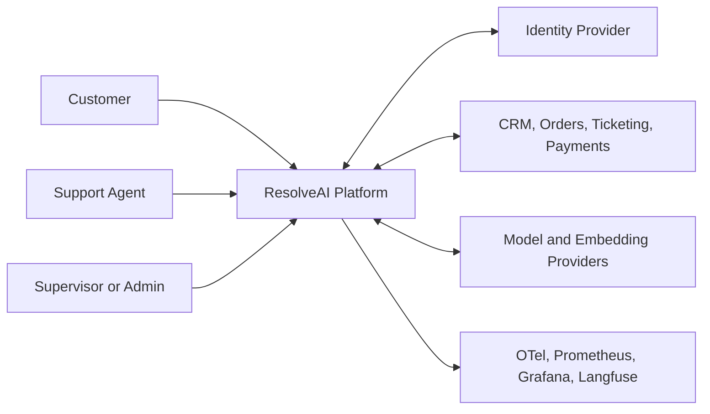
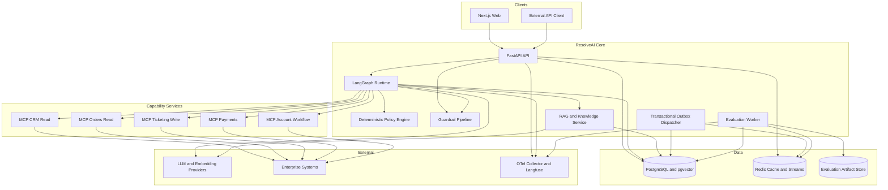
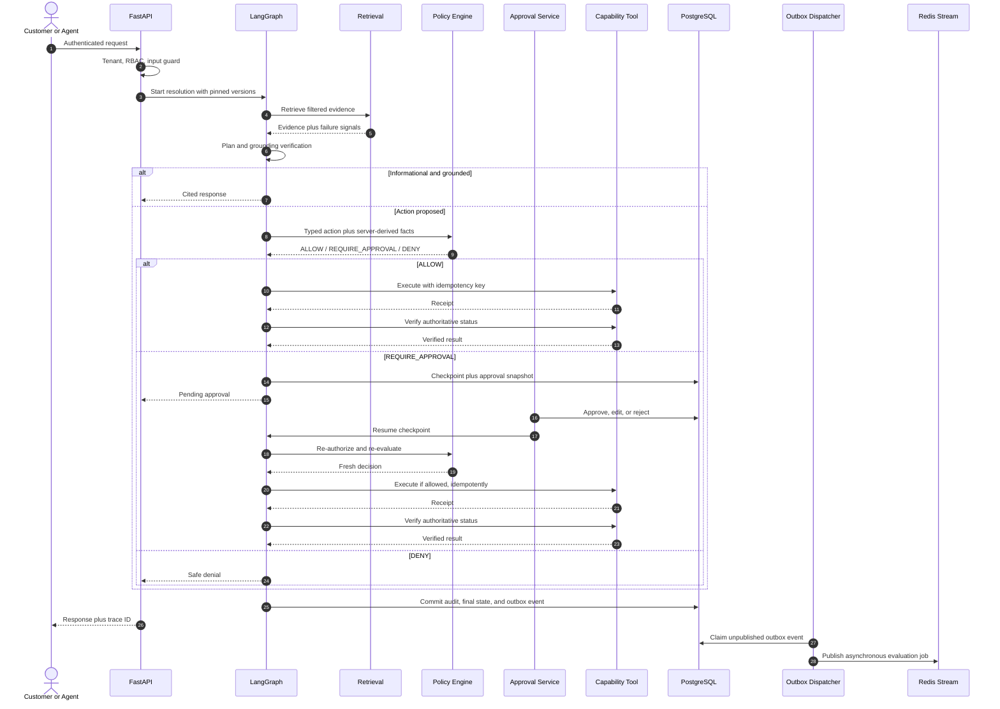
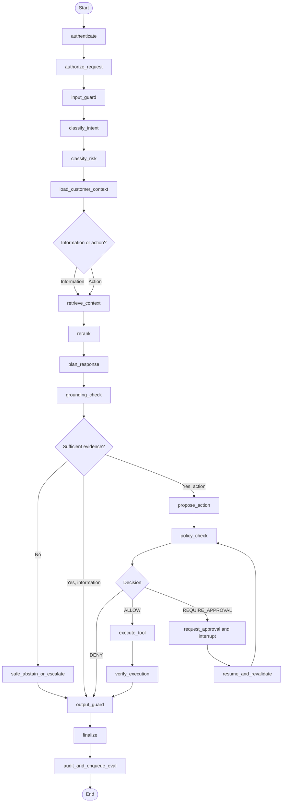

# ResolveAI Architecture

**Status:** End-to-end implementation baseline; external production acceptance pending  
**Last updated:** 2026-10-03  
**Scope:** Logical architecture and contracts; implemented portions are tracked in `ROADMAP.md`

## 1. Architectural drivers

ResolveAI optimizes for five properties in this order:

1. **Safety:** deterministic authorization, policy, approval, and execution boundaries.
2. **Evidence:** answers, actions, and verification remain traceable to sources.
3. **Recoverability:** state survives process failure and side effects are idempotent.
4. **Measurability:** versions, traces, costs, and evaluations can be compared honestly.
5. **Evolvability:** providers and retrieval strategies are replaceable behind typed ports.

The initial deployment is a modular monolith plus isolated capability services. PostgreSQL is the durable system of record. Redis supplies ephemeral cache/coordination and at-least-once streams. The design avoids a premature fleet of independently deployed microservices while preserving boundaries that can be extracted later.

## 2. System context



## 3. Container architecture



### 3.1 Deployment boundaries

- `apps/api` owns HTTP APIs, authentication middleware, graph invocation/resume, approval APIs, and synchronous response publication.
- `apps/eval-worker` owns asynchronous production sampling and offline experiment execution. It has no production write-tool credentials.
- `apps/web` consumes public APIs and never connects directly to databases or capability services.
- `packages/*` are in-process domain libraries with explicit ports.
- `services/mcp-*` isolate credentials and blast radius by capability. Read and write permissions are not combined merely for convenience.
- PostgreSQL remains authoritative for workflow state, policies/versions, approvals, audits, and experiment metadata.
- Redis is disposable from a correctness perspective; loss may reduce availability or require re-enqueueing, but cannot erase authoritative state.

## 4. Runtime request flow



The response is not delayed for expensive evaluation. Enqueue failure is recorded and repaired from authoritative `agent_runs`/outbox state; it does not silently discard the evaluation obligation.

An `EDIT` decision does not continue the original proposal toward execution. It closes that approval request, creates a replacement proposal/digest, and returns through authorization and policy evaluation. If approval is still required, the graph interrupts on a new approval request. The initial implementation supports one authorized terminal decision per approval request; multi-approver quorum workflows are deferred until explicitly modeled.

## 5. Trust boundaries and data flow rules

| Boundary | Trust rule | Enforcement |
|---|---|---|
| Client → API | All client input is untrusted | Authentication, schema validation, tenant derivation, rate/size limits, input guardrails |
| API → model | Only minimum necessary, redacted context | Prompt templates, typed envelopes, PII/secret redaction, token budget |
| RAG/tool → model | Content is data, never instruction | Trust labels, delimiter/encoding, injection quarantine, allowed-use metadata |
| Model → application | Output is an untrusted proposal | Strict schemas, allow-listed action types, grounding checks, policy evaluation |
| Application → capability service | Caller identity is service-authenticated and scoped | mTLS/token scopes, authorization context, idempotency, timeouts |
| Capability service → enterprise system | Provider response is untrusted evidence | Schema normalization, error mapping, verification reads |
| Core → telemetry | Telemetry is data-minimized | Attribute allow-list, hashing/redaction, cardinality controls |

## 6. Domain data model

### 6.1 Database conventions

- PostgreSQL 16+ with `pgcrypto`, `vector`, and `citext` where useful.
- UUID primary keys generated server-side.
- `tenant_id UUID NOT NULL` on tenant-owned records; global registries are explicitly marked.
- `created_at TIMESTAMPTZ NOT NULL DEFAULT now()` and `updated_at TIMESTAMPTZ NOT NULL DEFAULT now()` on mutable records.
- Money uses integer minor units plus ISO 4217 currency, never floating point.
- Mutable business records use `version BIGINT NOT NULL DEFAULT 1` for optimistic concurrency.
- Status fields use check constraints or PostgreSQL enums introduced by migrations.
- Each tenant-owned parent exposes `UNIQUE (tenant_id, id)`. Child relationships use composite foreign keys such as `(tenant_id, customer_id) REFERENCES customers(tenant_id, id)`; application-only tenant checks are insufficient. Parent/child identity invariants that cannot be expressed by one foreign key use a constraint trigger and a matching integration test.
- Global-or-tenant unique keys use PostgreSQL 15+ `UNIQUE NULLS NOT DISTINCT` or separate partial unique indexes for `tenant_id IS NULL` and `tenant_id IS NOT NULL`; default nullable-unique semantics are not accepted.
- Soft deletion is used only when business/audit semantics require it. Legal deletion uses tombstones and retention workflows.
- Row-level security is enabled for tenant-owned tables, with the transaction-local tenant established by trusted middleware.

### 6.2 Identity and tenancy

| Table | Required fields and constraints | Key indexes |
|---|---|---|
| `tenants` | `id`, unique `slug`, `name`, `status`, `settings_json`, timestamps | unique `slug`; `status` |
| `users` | `id`, nullable `tenant_id` only for controlled platform operators, unique `(tenant_id, external_subject)`, `email CITEXT`, `display_name`, `status`, `last_login_at`, timestamps | `(tenant_id, email)`; `(tenant_id, status)` |
| `conversations` | `id`, `tenant_id`, `customer_id`, nullable `ticket_id`, `channel`, `status`, `external_ref`, timestamps; tenant-consistent customer/ticket FKs | unique nullable `(tenant_id, external_ref)`; `(tenant_id, customer_id, updated_at DESC)` |
| `customers` | `id`, `tenant_id`, unique `(tenant_id, external_ref)`, optional `user_id`, `email`, `name`, `locale`, `status`, `pii_classification`, timestamps | `(tenant_id, email)`; `(tenant_id, status)` |
| `support_agents` | `id`, `tenant_id`, unique `user_id`, `team`, `status`, timestamps | `(tenant_id, team, status)` |
| `roles` | `id`, nullable `tenant_id` for platform templates, `name`, `description`, unique `(tenant_id, name)` | `(tenant_id, name)` |
| `permissions` | `id`, unique `code`, `resource`, `action`, `description` | `(resource, action)` |
| `role_permissions` | `role_id`, `permission_id`, composite primary key | `permission_id` |
| `user_roles` | `tenant_id`, `user_id`, `role_id`, `scope_json`, `granted_by`, `granted_at`, `expires_at`, composite primary key `(tenant_id,user_id,role_id)` | `(tenant_id, role_id)`; `expires_at` |

### 6.3 Commerce and support

| Table | Required fields and constraints | Key indexes |
|---|---|---|
| `orders` | `id`, `tenant_id`, `customer_id`, unique `(tenant_id, external_ref)`, `status`, `currency CHAR(3)`, `subtotal_minor`, `tax_minor`, `shipping_minor`, `total_minor`, `placed_at`, `version`, timestamps; amounts nonnegative | `(tenant_id, customer_id, placed_at DESC)`; `(tenant_id, status)` |
| `order_items` | `id`, `tenant_id`, `order_id`, `sku`, `name`, `quantity > 0`, `unit_price_minor >= 0`, `total_minor >= 0`, timestamps | `(tenant_id, order_id)`; `(tenant_id, sku)` |
| `shipments` | `id`, `tenant_id`, `order_id`, unique `(tenant_id, carrier, tracking_number)`, `status`, `estimated_delivery_at`, `delivered_at`, `last_event_at`, `version`, timestamps | `(tenant_id, order_id)`; `(tenant_id, status, last_event_at)` |
| `payments` | `id`, `tenant_id`, `order_id`, unique `(tenant_id, provider, provider_payment_ref)`, `status`, `amount_minor`, `currency`, `method_type`, `method_fingerprint`, `authorized_at`, `captured_at`, `version`, timestamps; no PAN/CVV storage | `(tenant_id, order_id)`; `(tenant_id, status)` |
| `refunds` | `id`, `tenant_id`, `payment_id`, `order_id`, unique nullable `(tenant_id, provider_ref)`, unique `(tenant_id, idempotency_key)`, `status`, `amount_minor > 0`, `currency`, `reason_code`, `requested_by`, `approved_request_id`, `executed_at`, `failure_code`, `version`, timestamps | `(tenant_id, order_id, created_at DESC)`; `(tenant_id, status)` |
| `support_tickets` | `id`, `tenant_id`, `customer_id`, unique `(tenant_id, external_ref)`, `subject`, `status`, `priority`, `assigned_agent_id`, `channel`, `opened_at`, `closed_at`, `version`, timestamps | `(tenant_id, status, priority)`; `(tenant_id, customer_id, created_at DESC)`; `(tenant_id, assigned_agent_id, status)` |
| `ticket_messages` | `id`, `tenant_id`, `ticket_id`, `author_type`, nullable `author_user_id`, `direction`, encrypted/redacted `body`, `body_sha256`, `external_ref`, `sent_at`, timestamps | `(tenant_id, ticket_id, sent_at)`; unique nullable `(tenant_id, external_ref)` |

### 6.4 Knowledge and retrieval

| Table | Required fields and constraints | Key indexes |
|---|---|---|
| `knowledge_documents` | `id`, `tenant_id`, unique `(tenant_id, source_uri)`, `title`, `document_type`, `policy_category`, `audience`, `status`, `current_version_id`, timestamps | `(tenant_id, status, policy_category)` |
| `knowledge_document_versions` | `id`, `tenant_id`, `document_id`, `version_number`, `checksum_sha256`, `content_uri`, `mime_type`, `language`, `effective_from`, `effective_to`, `supersedes_version_id`, `ingestion_status`, `metadata_json`, timestamps; unique `(document_id, version_number)` | `(tenant_id, document_id, version_number DESC)`; `(tenant_id, effective_from, effective_to)` |
| `knowledge_chunks` | `id`, `tenant_id`, `document_version_id`, `rag_version_id`, `parent_chunk_id`, `ordinal`, `heading_path`, `content`, `content_sha256`, `token_count`, `metadata_json`, `embedding vector(N)`, `embedding_model_version_id`, timestamps; unique `(document_version_id, rag_version_id, ordinal)` | HNSW on embedding per supported dimension/model strategy; GIN FTS expression; `(tenant_id, document_version_id)`; `(tenant_id, rag_version_id)` |
| `retrieval_events` | `id`, `tenant_id`, `agent_run_id`, `query_hash`, `rag_version_id`, `stage`, `result_count`, `latency_ms`, `top_scores_json`, `failure_category`, `details_json`, timestamps | `(tenant_id, agent_run_id)`; `(tenant_id, failure_category, created_at)` |
| `citations` | `id`, `tenant_id`, `agent_run_id`, `chunk_id`, `claim_id`, `display_label`, `quote_start`, `quote_end`, `entailment_status`, `verifier_version`, timestamps | `(tenant_id, agent_run_id)`; `(chunk_id)` |

Embedding dimensions cannot vary within one pgvector column. If multiple dimensions are required, use separate embedding tables/columns by model family rather than nullable dimension-specific fields.

`knowledge_documents.current_version_id` is constrained to `(tenant_id, document_id, version_id)` through a composite candidate key on `knowledge_document_versions`; it cannot point to another document’s version. The same composite-FK rule applies throughout commerce, support, citations, runs/steps/tools, proposals/policy decisions, and approval chains. Migration tests enumerate these relationships and attempt cross-tenant and wrong-parent inserts.

### 6.5 Agent workflow, tools, approval, and audit

| Table | Required fields and constraints | Key indexes |
|---|---|---|
| `agent_runs` | `id`, `tenant_id`, `conversation_id`, `request_id`, `principal_id`, `customer_id`, `ticket_id`, `status`, `intent`, `risk_level`, `graph_version`, `rag_version_id`, `prompt_version_id`, `model_version_id`, `trace_id`, `started_at`, `completed_at`, `failure_category`, `version_tuple_json`, timestamps | unique `(tenant_id, request_id)`; `(tenant_id, status, created_at)`; `trace_id` |
| `agent_steps` | `id`, `tenant_id`, `agent_run_id`, `step_index`, `node_name`, `attempt`, `status`, `input_digest`, `output_digest`, redacted `details_json`, `started_at`, `completed_at`, `error_category`, timestamps; unique `(agent_run_id, step_index, attempt)` | `(tenant_id, agent_run_id, step_index)`; `(node_name, status, created_at)` |
| `graph_checkpoints` | `id`, `tenant_id`, `agent_run_id`, `thread_id`, `checkpoint_namespace`, `checkpoint_id`, encrypted `state_payload`, `state_schema_version`, `parent_checkpoint_id`, timestamps; unique `(thread_id, checkpoint_namespace, checkpoint_id)` | `(tenant_id, agent_run_id, created_at DESC)` |
| `authorization_decisions` | `id`, `tenant_id`, `agent_run_id`, nullable `action_proposal_id`, `principal_id`, `resource_type`, `resource_id`, `permission_code`, `decision`, `reason_code`, `roles_digest`, `context_digest`, timestamps | `(tenant_id, agent_run_id)`; `(tenant_id, principal_id, created_at)` |
| `tool_calls` | `id`, `tenant_id`, `agent_run_id`, `agent_step_id`, `tool_name`, `tool_version`, `capability`, `status`, `idempotency_key`, `arguments_digest`, redacted `arguments_json`, redacted `result_json`, `provider_receipt`, `authorization_decision_id`, `started_at`, `completed_at`, `error_category`, timestamps | unique partial `(tenant_id, tool_name, idempotency_key)` for side effects; `(tenant_id, agent_run_id)` |
| `action_proposals` | `id`, `tenant_id`, `agent_run_id`, `action_type`, `action_schema_version`, normalized `parameters_json`, `action_digest`, `status`, `rationale`, `evidence_ids`, `proposed_by_step_id`, timestamps | unique `(tenant_id, action_digest, agent_run_id)`; `(tenant_id, status)` |
| `policy_decisions` | `id`, `tenant_id`, `agent_run_id`, `action_proposal_id`, `policy_id`, `policy_version`, `decision`, `reason_code`, `risk_level`, `required_approver_role`, `facts_digest`, redacted `facts_json`, timestamps | `(tenant_id, agent_run_id)`; `(policy_id, policy_version, decision)` |
| `approval_requests` | `id`, `tenant_id`, `agent_run_id`, `action_proposal_id`, `action_digest`, `policy_decision_id`, `status`, `required_role`, `requested_by`, `expires_at`, `resolved_at`, immutable `snapshot_json`, `version`, timestamps | `(tenant_id, status, created_at)`; `(tenant_id, required_role, status)` |
| `approval_decisions` | `id`, `tenant_id`, `approval_request_id`, `reviewer_id`, `decision`, `reason`, `original_action_digest`, nullable `replacement_action_proposal_id`, nullable `resulting_action_digest`, `modified_parameters_json`, timestamps; exactly one terminal decision per request in the initial model | unique `(tenant_id, approval_request_id)`; `(tenant_id, reviewer_id, created_at)` |
| `audit_events` | `id`, `tenant_id`, `sequence_no`, `occurred_at`, `actor_type`, `actor_id`, `event_type`, `resource_type`, `resource_id`, `outcome`, `trace_id`, redacted `payload_json`, `previous_hash`, `event_hash`; append-only/tamper-evident | unique `(tenant_id, sequence_no)`; `(tenant_id, resource_type, resource_id)`; `(tenant_id, occurred_at)` |
| `guardrail_events` | `id`, `tenant_id`, `agent_run_id`, `stage`, `guardrail`, `guardrail_version`, `decision`, `reason_code`, `input_digest`, `output_digest`, redacted `sample_json`, `latency_ms`, `model_version_id`, timestamps | `(tenant_id, agent_run_id)`; `(guardrail, decision, created_at)` |

### 6.6 Version registries

| Table | Required fields and constraints | Key indexes |
|---|---|---|
| `prompt_versions` | `id`, optional `tenant_id`, `name`, `semantic_version`, `template_sha256`, `template_uri`, `variables_schema_json`, `status`, `created_by`, timestamps; unique `(tenant_id,name,semantic_version)` | `(tenant_id, name, status)` |
| `rag_versions` | `id`, optional `tenant_id`, unique `(tenant_id, name)`, immutable chunker/embedding/retriever/reranker/filter/threshold configuration JSON, `config_sha256`, `status`, timestamps | `(tenant_id, status)` |
| `model_versions` | `id`, `provider`, `model_id`, `capability`, `parameters_json`, `context_limit`, `pricing_version_id`, `status`, effective dates; unique `(provider,model_id,capability,effective_from)` | `(provider, model_id, status)` |
| `policy_versions` | `id`, optional `tenant_id`, `policy_id`, `version`, `rules_json`, `rules_sha256`, `status`, `effective_from`, `effective_to`, `created_by`, timestamps; unique `(tenant_id,policy_id,version)` | `(tenant_id, policy_id, status)` |
| `pricing_versions` | `id`, `provider`, `model_or_service`, `currency`, per-unit prices, `source_uri`, `effective_from`, `effective_to`, timestamps | `(provider, model_or_service, effective_from DESC)` |

Immutable version records are never updated in place other than lifecycle status. Runs point to exact IDs, not mutable aliases such as “latest.”

Nullable tenant keys in `prompt_versions`, `rag_versions`, and `policy_versions` use `NULLS NOT DISTINCT`/partial indexes so only one global record can exist for a logical key. Evaluation datasets are always tenant-owned; shared templates are copied/versioned into a designated tenant rather than queried through a nullable scope. Platform operators and global records use separate authorization paths and do not rely on an absent tenant as implicit access.

### 6.7 Evaluation and cost

| Table | Required fields and constraints | Key indexes |
|---|---|---|
| `evaluation_datasets` | `id`, `tenant_id`, `name`, `version`, `description`, `source`, `license`, `content_sha256`, `status`, timestamps; unique `(tenant_id,name,version)` | `(tenant_id, status)` |
| `evaluation_cases` | `id`, `tenant_id`, `dataset_id`, stable `case_key`, `question`, `expected_answer`, `expected_documents_json`, `expected_action_json`, `forbidden_actions_json`, `category`, `difficulty`, `risk_level`, `tags_json`, `metadata_json`, timestamps; unique `(tenant_id,dataset_id,case_key)` | `(tenant_id, dataset_id, category, risk_level)` |
| `evaluation_runs` | `id`, `tenant_id`, `dataset_id`, `status`, `git_commit`, `dataset_version`, `dataset_sha256`, `graph_version`, `rag_version_id`, `prompt_version_id`, `model_version_id`, `embedding_model_version_id`, `policy_version_id`, `guardrail_bundle_version`, `tool_registry_version`, `pricing_version_id`, `evaluator_bundle_version`, nullable `random_seed`, validated immutable `config_json`, `config_sha256`, `environment`, `started_at`, `completed_at`, `failure_reason`, `artifact_uri`, timestamps | `(tenant_id, dataset_id, started_at DESC)`; `(tenant_id, status, created_at)` |
| `evaluation_results` | `id`, `tenant_id`, `evaluation_run_id`, `evaluation_case_id`, `agent_run_id`, `status`, `actual_answer`, `actual_documents_json`, `actual_action_json`, `latency_ms`, `cost_microusd`, `error_category`, timestamps; unique `(evaluation_run_id,evaluation_case_id)` | `(tenant_id, evaluation_run_id, status)`; `(evaluation_case_id)` |
| `evaluation_scores` | `id`, `tenant_id`, `evaluation_result_id`, `metric_name`, `metric_version`, nullable `score`, `passed`, `threshold`, `evaluator_type`, `evaluator_model_version_id`, `rationale_json`, `status`, timestamps; unique `(tenant_id,evaluation_result_id,metric_name,metric_version)` | `(tenant_id, metric_name, score)` |
| `cost_events` | `id`, `tenant_id`, `agent_run_id`, `agent_step_id`, `provider`, `service`, `model_version_id`, `feature`, `prompt_version_id`, `rag_version_id`, `input_tokens`, `output_tokens`, `cached_tokens`, `quantity`, `unit`, nullable `cost_microusd`, `pricing_version_id`, `usage_source`, timestamps | `(tenant_id, created_at)`; `(agent_run_id)`; `(provider, model_version_id, created_at)` |

`NULL cost_microusd` means unknown price/usage. Zero means a verified zero charge. These meanings must never be conflated.

Tenant-owned evaluation children carry `tenant_id` and composite parent keys so RLS does not depend on an application join. Artifact objects use tenant-prefixed keys, encryption, short-lived signed access, checksum verification, and the same evaluation authorization policy. The concrete S3-compatible/local artifact backend and retention schedule remain Phase 1/open-decision inputs; until selected, artifact durability is a design requirement rather than an implemented claim.

### 6.8 Transactional outbox

`outbox_events(id, tenant_id, aggregate_type, aggregate_id, event_type, payload_json, traceparent, status, attempts, available_at, created_at, published_at)` is written in the same PostgreSQL transaction as the authoritative state change. A dispatcher publishes to Redis Streams. Cache keys and stream payloads begin with/contain the server-derived tenant ID, and consumers compare it with the referenced aggregate before processing. Consumers are idempotent and record `inbox_receipts(consumer, event_id, tenant_id, processed_at, outcome)`.

This provides atomic state-plus-intent, not exactly-once delivery.

## 7. LangGraph state and execution model

### 7.1 State contract

The implementation will use a versioned Pydantic model conceptually equivalent to:

```python
class ResolutionState(BaseModel):
    schema_version: Literal["1"]
    run_id: UUID
    request_id: UUID
    thread_id: str
    trace_id: str
    tenant_id: UUID
    principal: PrincipalSnapshot
    deadline_at: datetime

    request: RequestEnvelope
    intent: IntentResult | None = None
    risk: RiskResult | None = None
    customer: CustomerSnapshot | None = None
    conversation: list[Message] = []

    version_tuple: VersionTuple
    retrieval_query: str | None = None
    evidence: list[EvidenceItem] = []
    retrieval_failures: list[RetrievalFailure] = []
    draft: DraftResponse | None = None
    grounding: GroundingResult | None = None

    proposed_action: ActionProposal | None = None
    policy_decision: PolicyDecision | None = None
    approval: ApprovalSnapshot | None = None
    execution: ExecutionResult | None = None
    verification: VerificationResult | None = None

    guardrail_events: list[GuardrailResult] = []
    failures: list[FailureRecord] = []
    status: RunStatus
    next_node: str | None = None
    step_count: int = 0
    tool_call_count: int = 0
    action_signature_counts: dict[str, int] = {}
```

All nested models forbid unknown fields. State stores redacted/minimum data and stable references to large artifacts rather than arbitrary provider payloads.

### 7.2 Node graph



### 7.3 Durability and replay rules

- Checkpoint before an interrupt and before any side effect.
- Create an execution record with a unique idempotency key before invoking a side-effecting tool.
- On replay, inspect the execution record/provider receipt before reissuing the call.
- Store approval snapshots outside mutable graph state and reference them by ID/digest.
- Resume requires the same tenant, run, checkpoint namespace, and valid caller permission.
- Re-run authentication/authorization and policy after resume.
- Maximum steps and tool calls are configuration values recorded in the run.
- A repeated normalized action signature above its limit emits `agent.loop` and terminates safely.
- Node transitions use explicit status values; no exception text determines business routing.

## 8. Policy model

### 8.1 Inputs and output

The policy engine accepts only typed, server-assembled facts:

```text
PolicyInput
  tenant configuration and policy version
  authenticated principal, roles, permissions, assignment scope
  customer/resource tenant and ownership
  action type and validated normalized parameters
  order/payment/refund/account state and versions
  risk signals and guardrail outcomes
  prior action totals and rate limits
  approval context, if resuming
  current time and environment

PolicyDecision
  decision: ALLOW | REQUIRE_APPROVAL | DENY
  policy_id and policy_version
  reason_code and human-readable reason
  risk_level
  required_approver_role (nullable)
  obligations (verification, two-person approval, expiry, logging)
  facts_digest and action_digest
```

### 8.2 Rule precedence

1. Tenant mismatch, prohibited capability, missing identity, secret access, and invalid resource state return `DENY`.
2. Missing facts required for a side effect return `DENY` or a non-executing escalation reason.
3. Applicable approval thresholds and high-risk categories return `REQUIRE_APPROVAL`.
4. Explicit allow rules may return `ALLOW` only after authorization and all deny predicates have passed.
5. No matching rule fails closed for actions and may abstain for informational requests.

An action is executable only when authentication and resource authorization pass, a fresh policy evaluation has no deny outcome, and all returned obligations are satisfied. For `REQUIRE_APPROVAL`, the execution gate validates an unexpired approval for the exact action/facts digest; it does not reinterpret the approval as a model or role override.

The initial workflow implements one approver. If a policy version contains a two-person/quorum obligation before the corresponding quorum schema and workflow are implemented, policy validation rejects that version and execution fails closed.

### 8.3 Initial policy matrix

| Action | Baseline decision | Conditions/obligations |
|---|---|---|
| `order.read` / `shipment.read` | ALLOW | Same tenant; customer owns resource or agent has scoped case access |
| `ticket.create` / `ticket.note.add` | ALLOW | Same tenant; content/output guard passes; agent/customer scope valid |
| `refund.propose` | ALLOW | Same tenant; refundable payment; amount within remaining refundable balance |
| `refund.execute` at/below tenant autonomous threshold | ALLOW | Authorized role; low risk; no deny flags; idempotent; verify receipt |
| `refund.execute` above autonomous threshold and at/below approval ceiling | REQUIRE_APPROVAL | Supervisor or configured role; unexpired approval bound to action digest |
| `refund.execute` above hard ceiling | DENY | Human approval cannot override platform hard ceiling; use external exception process |
| `account.close.request` | REQUIRE_APPROVAL | Identity verification, retention assessment, and authorized reviewer |
| `payment.destination.change` | DENY initially | No supported production capability in initial release |
| `payment.secret.read` | DENY | Tool does not exist; audit attempted access |
| any cross-tenant action | DENY | Security event and no downstream call |

Threshold values are tenant configuration within platform limits and are intentionally not invented in this document.

## 9. RAG configuration and failure model

### 9.1 Immutable RAG version

```yaml
name: rag_v001
chunker:
  type: heading_aware
  parameters: {}
embedding:
  model_version_id: <uuid>
retrieval:
  mode: hybrid
  dense_top_k: <configured>
  keyword_top_k: <configured>
  fusion: reciprocal_rank_fusion
reranker:
  model_version_id: <uuid-or-null>
  top_n: <configured>
thresholds:
  minimum_relevance: <calibrated>
  minimum_reranker_score: <calibrated>
filters:
  enforce_tenant: true
  enforce_audience: true
  enforce_effective_date: true
query_rewrite:
  enabled: true
  prompt_version_id: <uuid>
```

Values are populated by configuration/evaluation, not guessed in architecture documents.

### 9.2 Retrieval result contract

Each evidence item includes chunk/document/version IDs, source URI/title, text, dense/keyword/reranker scores, rank contributions, freshness/effective dates, tenant/audience metadata, and content checksum. The model receives only evidence that passed filters and quarantine.

### 9.3 Failure classification

`ZERO_RESULTS`, `LOW_SIMILARITY`, `LOW_RERANKER_SCORE`, `CONFLICTING_DOCUMENTS`, `STALE_POLICY`, `MISSING_POLICY_CATEGORY`, `DENSE_KEYWORD_DISAGREEMENT`, `CITATION_UNSUPPORTED`, `INSUFFICIENT_EVIDENCE`, `TIMEOUT`, `EMBEDDING_FAILURE`, and `VECTOR_DB_FAILURE` are structured codes. A run may contain multiple codes. Conflict and stale-policy detection are policy-category/effective-date aware, not generic cosine-score heuristics.

## 10. Evaluation model

### 10.1 Experiment identity

An experiment is uniquely described by:

`git_commit + dataset_id/version/hash + graph_version + rag_version_id + prompt_version_id + model_version_id + embedding_model_version_id + evaluator_versions + environment + random/seed settings where supported`.

### 10.2 Evaluator tiers

1. **Deterministic:** schema validity, expected/forbidden action, authorization/policy decision, citation source identity, retrieval hit/recall, PII/secret patterns, tool trajectory, latency/cost arithmetic.
2. **Semantic deterministic/statistical:** normalized string/entity match, embedding similarity where justified, ranking metrics.
3. **Framework metrics:** DeepEval and RAGAS adapters with pinned versions.
4. **LLM judge:** relevancy, nuanced correctness, or tone only when lower tiers are insufficient; judge model/prompt and repeated-sample strategy are recorded.

Scores include `status` (`MEASURED`, `NOT_APPLICABLE`, `EVALUATOR_FAILED`, `MISSING_INPUT`) so absent evidence never becomes a zero or a pass.

### 10.3 Comparison rules

- Compare the same case IDs; report missing/failed cases.
- Show sample count, mean/median where relevant, percentile latency, total/mean cost, and safety counts.
- Prefer paired deltas and confidence intervals/bootstrapping for noisy metrics.
- Safety invariants are gates, not weighted away by a higher average quality score.
- Candidate selection is a human decision supported by a Pareto view of quality, safety, latency, and cost.

## 11. Telemetry model

### 11.1 Trace hierarchy

Root span: `resolveai.request`

```text
resolveai.request
├── auth.validate
├── guardrail.input
├── agent.run
│   ├── intent.classify
│   ├── risk.classify
│   ├── context.load
│   ├── rag.query_rewrite
│   ├── rag.embedding
│   ├── rag.dense_retrieve
│   ├── rag.keyword_retrieve
│   ├── rag.fuse
│   ├── rag.rerank
│   ├── llm.generate
│   ├── grounding.verify
│   ├── policy.evaluate
│   ├── approval.wait (linked across resume, not one open span)
│   ├── tool.invoke
│   ├── tool.verify
│   └── guardrail.output
├── audit.persist
└── evaluation.enqueue
```

Approval waiting is represented by an end event/span plus a span link on resume; a span is not held open for days.

### 11.2 Safe span attributes

Allowed examples: opaque `tenant_id`, run ID, graph/RAG/prompt/model versions, node/tool name, status, retrieval count, token counts, computed cost, policy decision/reason code, guardrail decision, error category, and payload size. Customer names, email addresses, message bodies, retrieved chunk text, full tool arguments, secrets, and raw model prompts are excluded from normal OTel attributes.

Collector, Langfuse, and artifact access is authenticated and tenant/role filtered at the ResolveAI API; the browser never receives backend administrative credentials. Backend-native projects/organizations are separated by environment, and any per-tenant partitioning limitations are documented and compensated by the API access layer. Cross-tenant platform support uses an explicit break-glass permission and produces an audit event.

### 11.3 Metrics and cardinality

Prometheus names use a `resolveai_` prefix and base units:

- counters: `requests_total`, `request_errors_total`, `retrieval_failures_total`, `guardrail_triggers_total`, `tool_calls_total`, `tool_failures_total`, `approvals_requested_total`, `approvals_accepted_total`, `approvals_rejected_total`, `human_escalations_total`, `model_fallbacks_total`, `agent_loops_detected_total`, `input_tokens_total`, `output_tokens_total`, `cost_usd_total`;
- histograms: `request_duration_seconds`, `llm_duration_seconds`, `retrieval_duration_seconds`, `tool_duration_seconds`, `approval_wait_duration_seconds`, `cost_usd_per_request`;
- gauges: queue depth/age, open approvals, circuit state, and dependency readiness.

Labels are bounded enums such as endpoint template, method, status class, model alias, tool name, policy decision, failure category, and environment. `tenant_id`, user/customer/run/trace IDs, raw URLs, query text, and error messages are never Prometheus labels. Per-tenant cost is queried from cost events or analytics storage, not emitted as a high-cardinality metric label.

### 11.4 Logs, audit, and correlation

Structured logs contain timestamp, severity, service, environment, trace/span/run IDs, event name, status, and stable error code. Audit events answer who did what to which resource, under which policy/approval, and with what outcome. The runtime database role has INSERT-only access through an audit function; UPDATE/DELETE are denied, sequence/hash-chain creation is serialized per tenant, and export/retention controls protect the chain. Operational logs are mutable/retained for troubleshooting; audit history is append-only and tamper-evident, not claimed absolutely immutable. They are related but not interchangeable.

### 11.5 Cost accounting

At each billed call, record provider-reported token/usage fields and link an effective pricing version. Computation uses integer micro-USD precision. Cached input, batch embeddings, reranker units, and measurable external tool charges are separate event types. Aggregations must expose unknown-cost counts.

## 12. Failure taxonomy and resilience

| Domain | Codes | Default handling |
|---|---|---|
| Model | `TIMEOUT`, `RATE_LIMIT`, `PROVIDER_ERROR`, `MALFORMED_OUTPUT` | Bounded retry if safe, configured fallback, then escalation |
| Retrieval | Codes in §9.3 | Degrade only when configured; otherwise abstain/escalate |
| Tool | `TIMEOUT`, `VALIDATION_ERROR`, `UNAUTHORIZED`, `DEPENDENCY_FAILURE`, `UNKNOWN_OUTCOME` | Never blind-retry an unknown side-effect outcome; reconcile using idempotency/provider receipt |
| Agent | `LOOP`, `MAX_STEPS`, `INVALID_STATE` | Stop safely, persist state, escalate |
| Policy | `DENIED`, `APPROVAL_REQUIRED`, `POLICY_UNAVAILABLE` | No execution; approval only for the approval-required state |
| Infrastructure | `POSTGRES`, `REDIS`, `VECTOR`, `QUEUE`, `NETWORK` | Readiness impact, circuit/backoff, recovery/outbox replay |

Errors expose safe public codes and correlation IDs. Provider details are retained only in restricted, redacted diagnostics.

## 13. Repository structure

Only directories with implemented content are created. This target tree is introduced incrementally:

```text
resolve-ai/
├── apps/
│   ├── api/                    # FastAPI composition root and HTTP contracts
│   ├── eval-worker/            # Offline/online evaluation jobs
│   └── web/                    # Next.js support and operations UI
├── packages/
│   ├── agent/                  # LangGraph state, nodes, routing, checkpoints
│   ├── common/                 # Shared IDs, time, errors, config primitives
│   ├── cost/                   # Usage normalization, pricing, aggregation
│   ├── evaluation/             # Dataset/run/evaluator contracts and reports
│   ├── guardrails/             # Input, external-content, and output boundaries
│   ├── observability/          # OTel, metrics, logging, Langfuse adapters
│   ├── policies/               # Deterministic authorization/action policies
│   ├── rag/                    # Ingestion, chunking, retrieval, reranking
│   └── tools/                  # Client ports, schemas, auth/idempotency wrappers
├── services/
│   ├── mcp-crm/                # Customer/history read capability
│   ├── mcp-account/            # Account-closure workflow capability
│   ├── mcp-orders/             # Order/shipment read capability
│   ├── mcp-payments/           # Refund proposal/execution capability
│   └── mcp-ticketing/          # Ticket/note write capability
├── infrastructure/
│   ├── docker/                 # Images and entrypoints
│   ├── grafana/                # Provisioning and dashboards
│   ├── otel/                   # Collector config
│   ├── postgres/               # Extensions and local bootstrap only
│   ├── prometheus/             # Scrape/rule config
│   └── redis/                  # Local Redis config
├── migrations/                 # Ordered Alembic migrations
├── datasets/
│   ├── adversarial/            # Versioned attack cases
│   ├── eval/                   # Golden evaluation cases and manifests
│   └── kb/                     # Synthetic demo knowledge corpus
├── experiments/                # Config manifests; generated results ignored or artifacted
├── tests/
│   ├── adversarial/
│   ├── integration/
│   ├── regression/
│   └── unit/
├── docs/
│   ├── architecture/
│   ├── decisions/
│   ├── evaluation/
│   ├── runbooks/
│   └── security/
├── scripts/                    # Developer/admin entrypoints with safe defaults
├── .github/workflows/
├── compose.yaml
├── Makefile
├── pyproject.toml
├── package.json
└── README.md
```

The initial four Phase 0 documents live directly under `docs/`. Subdirectories appear only when their first real document is added.

## 14. Architecture acceptance checks

The Phase 1 implementation was accepted against these architecture checks:

- every side effect crosses authorization, policy, idempotency, audit, and verification boundaries;
- graph pause/resume and revalidation semantics are unambiguous;
- tenant isolation enforcement is completely specified for application and database layers, with implementation evidence required by the Phase 1 exit gate;
- tables cover the required domain and provenance without storing prohibited payment secrets;
- evaluation identity can reproduce a configuration and distinguishes missing measurements;
- telemetry has trace correlation and bounded-cardinality rules;
- Redis loss does not erase durable workflow truth;
- shadow evaluation is structurally unable to execute production side effects;
- resolved trade-offs and their implementation defaults are recorded in `DECISIONS.md`.
