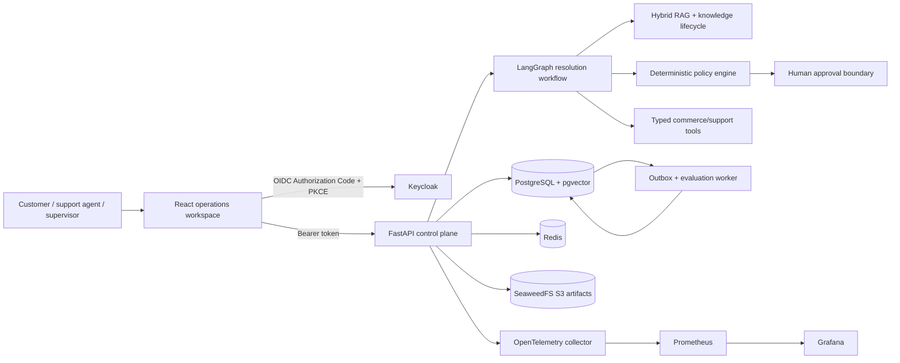
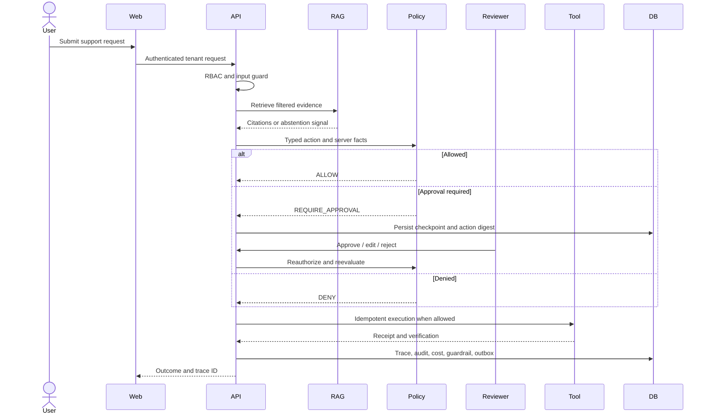

# ResolveAI implemented architecture

## End-to-end control flow

The local Docker topology contains PostgreSQL, Redis, Keycloak, SeaweedFS, API, a scheduled detector worker, a durable evaluation/outbox worker, OpenTelemetry Collector, Prometheus, Grafana, and the React web application.
